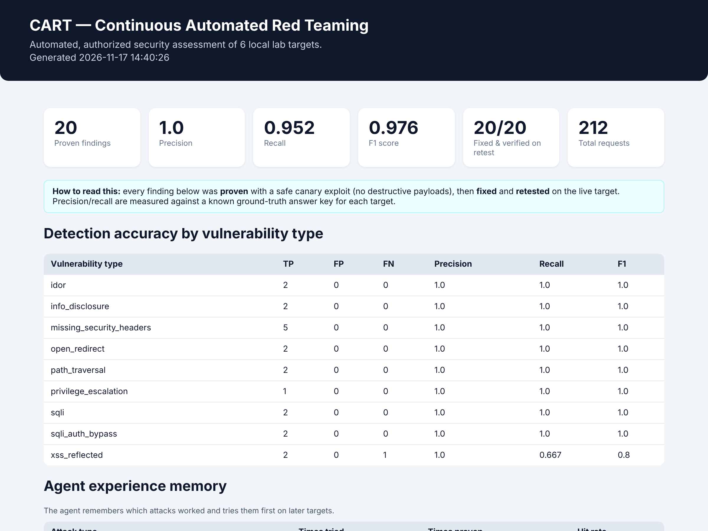
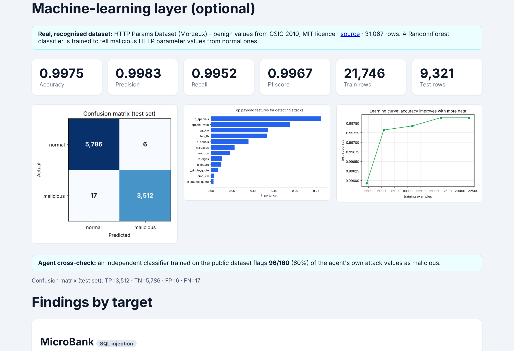

# CART — Continuous Automated Red Teaming

An automated security agent that **discovers, proves, fixes, and re-tests** web vulnerabilities, combined with a **machine-learning model** trained on a real public dataset to recognise malicious HTTP requests.

The agent's decision logic is **rule-based and transparent** (no black-box LLM), and the **machine-learning layer** adds a learned malicious-request classifier plus a triage signal — so the project is reproducible and every result can be explained.

All attacks run only against a local lab of intentionally vulnerable web applications built for this project.



---

## 1. Project Idea

Traditional vulnerability scanners produce long lists of *possible* issues, many of which are false positives. CART follows a different approach inspired by real red teams: **a vulnerability is only reported after it has been proven.**

The agent works through a full security pipeline:

```
Recon → Plan → Discover → Triage → Prove → Chain → Remediate → Retest → Score
```

| Stage | What the agent does |
|-------|---------------------|
| **Recon** | Crawls the target and maps its pages, forms, and parameters. |
| **Plan** | Decides which attack modules to run on each endpoint. |
| **Discover** | Sends lightweight probes to find suspicious behaviour. |
| **Triage** | Ranks candidates using the ML model and the agent's past experience. |
| **Prove** | Confirms each issue with a safe, harmless proof (unique canary values, no damage). |
| **Chain** | Combines findings into multi-step attacks (e.g. privilege escalation). |
| **Remediate** | Explains the root cause and proposes a code fix for every proven finding. |
| **Retest** | Applies the fix and re-runs the exact same proof to verify it is closed. |
| **Score** | Measures precision, recall, and F1 against a known answer key. |

A **policy engine** (`policy.toml`) restricts the agent to allowed hosts, ports, and HTTP methods, enforces a rate limit, blocks destructive payloads, and records every request in an audit log.

### Vulnerability types covered
SQL injection · Authentication bypass · Reflected XSS · Path traversal · Information disclosure · IDOR (broken access control) · Open redirect · Missing security headers · Chained privilege escalation

---

## 2. The Test Lab

Six local web applications, each focused on a specific vulnerability class. One of them is fully secure and is used to measure false positives.

| Target | Focus | Port |
|--------|-------|:----:|
| **VulnShop** | Multiple vulnerabilities + chained privilege escalation | 5000 |
| **MicroBank** | SQL injection | 5001 |
| **DevBlog** | Cross-site scripting (XSS) | 5002 |
| **CloudFiles** | Path traversal & information disclosure | 5003 |
| **Chatly** | Access control (IDOR) & open redirect | 5004 |
| **SecureCorp** | Secure site (false-positive control) | 5005 |

---

## 3. Learning Approach

CART uses two complementary forms of learning.

### 3.1 Supervised Machine Learning — Malicious Request Classifier

| | |
|---|---|
| **Learning type** | Supervised learning (binary classification) |
| **Algorithm** | Random Forest (200 trees, max depth 16) |
| **Dataset** | [HTTP Params Dataset](https://github.com/Morzeux/HttpParamsDataset) — 31,067 labelled HTTP parameter values. Normal traffic comes from the **HTTP DATASET CSIC 2010**; attack samples include SQL injection, XSS, command injection, and path traversal. MIT licence. |
| **Features** | 18 interpretable features extracted from each request value (length, special-character ratio, quotes, SQL/XSS/command keywords, traversal patterns, entropy, …) |
| **Split** | Stratified 70% train / 30% test (21,746 / 9,321) |

**Results on the held-out test set**

| Accuracy | Precision | Recall | F1-score |
|:--------:|:---------:|:------:|:--------:|
| 0.9975 | 0.9983 | 0.9952 | 0.9967 |

To show these numbers are not the product of one lucky split, the training run also reports:

- **5-fold stratified cross-validation** — mean ± std for each metric across five folds of the whole dataset.
- **Leave-one-attack-type-out generalization** — one whole attack family (e.g. XSS, or path traversal) is removed from training, and the model is measured on that **unseen** family. This is a harder, more honest test of how well the classifier generalizes beyond patterns it has already seen.

The model is also used inside the agent's **Triage** stage to help decide which suspicious candidates to exploit first. The training run produces a confusion matrix, a feature-importance chart, a learning curve, and a generalization chart.



### 3.2 Experience Memory — Agent Learning from its Own Attempts

The agent keeps a memory of every attack it has tried and how often each attack type succeeded (hit rate). On later scans, attack types with a higher success rate are prioritised, so the agent adapts its strategy based on experience.

---

## 4. Results

| Metric | Value |
|--------|:-----:|
| Targets scanned | 6 |
| Proven vulnerabilities | **20** |
| Precision | **1.00** |
| Recall | **0.95** |
| F1-score | **0.98** |
| Fixed and verified on retest | **20 / 20** |
| False positives on the secure site | **0** |

The final report (`reports/report.html`) is **interactive**: a top-level **CART / ML** toggle splits the
security scan from the machine-learning layer. In the CART tab you pick **one target at a time** and filter
its findings by **attack type**; each finding is laid out as a staged table
(**Discover → Prove → Impact → Remediate → Retest**) with evidence, the vulnerable code, and the proposed fix.

### Limitations (honest reading)

- **The ML dataset is a known, relatively easy benchmark**, so the headline accuracy is high. Cross-validation
  shows the score is stable across folds, and the leave-one-attack-type-out test shows the (lower) performance
  on attack families the model never trained on — a more realistic generalization signal.
- **The scan's precision/recall are measured against a self-authored answer key.** The lab targets and their
  ground truth were built for this project, so these numbers measure "does the agent find the planted
  vulnerabilities" — a controlled benchmark, not real-world precision on unknown applications.

---

## 5. How to Run

**Requirements:** Python 3.10+

```bash
# 1. Create a virtual environment and install dependencies
python -m venv venv
source venv/bin/activate          # Windows: venv\Scripts\activate
pip install -r requirements.txt

# 2. Run the whole project with one command (security scan + ML + report)
python run.py
```

The report is saved to **`reports/report.html`** — open it in any browser.

### One command, with flags for each stage

`run.py` is the single entry point. By default it runs everything; the flags below run one stage at a time:

| Command | What it does |
|---------|--------------|
| `python run.py` | **Full run**: agent security scan **+** ML pipeline **+** report |
| `python run.py --scan-only` | Agent security scan **+** report (no ML) |
| `python run.py --ml-only` | ML pipeline only (dataset → train → cross-check) |
| `python run.py --report-only` | Rebuild `report.html` from saved results — **no new attack** |
| `python run.py --url http://localhost:8080` | Scan **one external URL** instead of the lab (must pass `policy.toml`) |
| `python run.py --targets bank blog` | Scan only some lab targets, then ML |

> `--report-only` is handy while tweaking the report: it re-renders the page from the saved
> `reports/report.json` without re-attacking the targets.

### Other tools

```bash
# Keep the six lab websites running to explore them in the browser (live demo)
python serve_targets.py

# Interactive Streamlit dashboard
streamlit run dashboard/app.py
```

> When scanning a user-provided URL there is no answer key, so the report shows the
> **proven findings and recommended fixes** only — precision/recall are not computed.
> The policy still applies: a host or port that is not listed in `policy.toml` is refused.

---

## 6. Project Structure

```
cart/          Security agent: policy engine, recon, attack modules, chaining, remediation, retest, scoring, report
targets/       The six local vulnerable web applications (the test lab)
ml/            Feature extraction, training (+ cross-validation & generalization), and triage model
dataset/       HTTP Params Dataset (raw data + source information)
models/        Trained classifier, charts, and the agent's experience memory
dashboard/     Streamlit dashboard
reports/       Generated HTML / JSON reports and attack graphs
tests/         Automated tests (pytest)
policy.toml    Scope and safety rules for the agent
run.py         Single entry point (full run, or a stage via flags)
serve_targets.py  Keep the lab sites running for a manual demo
```

---

## 7. Tech Stack

Python · Flask · Requests · scikit-learn · pandas · NetworkX · Matplotlib · Streamlit · pytest · GitHub Actions

---

## 8. Ethics & Safety

CART is built for education. It attacks **only** the local applications included in this repository, and the policy engine blocks any request outside that scope. All proofs use harmless canary values and never modify or destroy data.

## License

MIT
